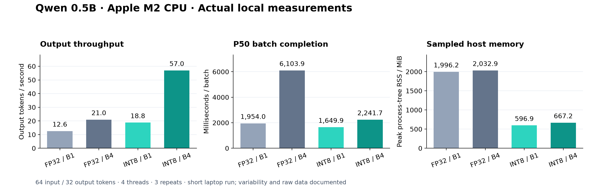

# LLM Inference Optimization Lab

Reproducible experiments on **Qwen · Hugging Face Transformers · vLLM · quantization · batching · Docker**.

This project asks a practical systems question: **how do batch size, runtime, and weight precision change inference throughput, latency, and memory?** It includes measured local CPU results, raw observations, an automated comparison report, and a separate NVIDIA GPU experiment matrix.

**Evidence status:** the local Qwen CPU experiments are real measurements. vLLM, CUDA NF4, and Docker execution have not been validated on GPU hardware in this environment. No GPU speedups are claimed.

## Results

### Local experiment: Apple Silicon CPU

Qwen2.5-0.5B-Instruct, FP32 or dynamic INT8, 4 CPU threads, 64 input tokens, exactly 32 generated tokens per request, 8 requests repeated 3 times, 1 warmup batch. Native macOS execution, not Docker. Short engineering experiments, not production capacity estimates. See [raw measurements](results/local/run-01/) and [measurement definitions](docs/methodology.md).

<!-- BENCHMARK:START -->
| Configuration | Batch | P50 batch latency (ms) | P95 (ms) | Output tok/s | Peak RSS (MiB) | Device VRAM (MiB) |
|---|---:|---:|---:|---:|---:|---:|
| HF baseline FP32 | 1 | 1954.05 | 5915.58 | 12.59 | 1996.2 | N/A |
| HF baseline FP32 | 4 | 6103.89 | 6589.97 | 20.97 | 2032.9 | N/A |
| HF dynamic INT8 | 1 | 1649.89 | 1875.23 | 18.76 | 596.9 | N/A |
| HF dynamic INT8 | 4 | 2241.68 | 2295.37 | 56.97 | 667.2 | N/A |
<!-- BENCHMARK:END -->



The local batch-4 comparison observed **2.72× output throughput** and **67.2% lower sampled RSS** with dynamic INT8 versus FP32. These are ratios from this short run; FP32 timing varied substantially. See the [full interpretation and limitations](docs/local-analysis.md).

### GPU comparison matrix

These rows intentionally remain unmeasured until the same GPU runs all configurations. CPU results cannot substitute for CUDA measurements.

| Configuration | Latency | Throughput | GPU memory | Status |
|---|---|---|---|---|
| HF baseline, FP16 | — | — | — | Requires NVIDIA GPU run |
| vLLM, FP16 | — | — | — | Requires NVIDIA GPU run |
| HF quantized, NF4 | — | — | — | Requires NVIDIA GPU run |

Each profile is swept at batch sizes **1, 4, 16**. All use the same model revision, token IDs, and output budget. [GPU config](configs/gpu.json)

## Quick start

Python 3.10–3.13; Python 3.11 is recommended for the pinned dependency sets.

```bash
python3 -m venv .venv
source .venv/bin/activate
pip install -e '.[hf,dev]'

# Downloads roughly 1 GB of public Qwen weights on first use.
llmbench run --backend hf --device cpu --dtype float32 \
  --batch-size 1 --out results/runs/baseline.json

# Runs four profiles in separate processes to isolate model allocations.
llmbench suite configs/local.json --out results/runs/local-01
llmbench report results/runs/local-01/hf-*.json \
  --out results/runs/local-01/report --readme README.md
pytest -q
```

To recreate the recorded macOS Python 3.13 environment, use `pip install -r requirements-local.lock.txt` and then `pip install --no-deps -e .`. That lock file describes the local CPU environment, not the GPU image. To regenerate the committed figure, install `.[plot]` and run `python scripts/plot_results.py`.

Use a fresh output directory for each suite; existing results are never silently overwritten by suite reruns. `run` writes to the exact `--out` path you supply. Default CPU workloads take several minutes, depending on hardware.

For a different causal model, pass **both** its identifier and revision:

```bash
llmbench run --model YOUR_ORG/YOUR_MODEL --revision main \
  --device cuda --dtype float16 --out results/runs/custom.json
```

Named revisions are resolved to immutable commit hashes before loading. The default Qwen revision is pinned to `7ae557604adf67be50417f59c2c2f167def9a775`. Gated models such as some Llama variants require their provider's access approval and normal Hugging Face authentication. Model licenses remain separate from this project's MIT code license.

## NVIDIA GPU and Docker

Use a Linux x86_64 host with a compatible NVIDIA driver, GPU, Docker, and NVIDIA Container Toolkit. The image pins vLLM 0.10.2; it supplies the CUDA/PyTorch stack. The small default model is intended to make the experiment accessible; results do not extrapolate directly to 7B/70B models.

```bash
docker build -t llm-inference-lab:gpu .
mkdir -p results/runs
docker run --rm --gpus '"device=0"' --ipc=host \
  -e HF_HUB_DISABLE_TELEMETRY=1 -e VLLM_NO_USAGE_STATS=1 \
  -v hf-cache:/root/.cache/huggingface \
  -v "$PWD/results/runs:/workspace/results/runs" \
  llm-inference-lab:gpu suite configs/gpu.json --out results/runs/gpu-01

# Reporting needs only the base package, not a GPU.
llmbench report results/runs/gpu-01/hf-*.json results/runs/gpu-01/vllm-*.json \
  --out results/runs/gpu-01/report
```

The GPU image runs HF baseline, vLLM and HF NF4 inside the same software environment. Do not install `.[hf,vllm]` together: the two optional extras pin different PyTorch/Transformers stacks. For a native vLLM environment, use a separate venv with `pip install -e '.[vllm,quant]' nvidia-ml-py==12.570.86`; this environment can also run the HF GPU profiles.

CPU container alternative (its numbers form a separate cohort from native macOS):

```bash
docker build -f Dockerfile.cpu -t llm-inference-lab:cpu .
docker run --rm -v hf-cache:/root/.cache/huggingface \
  -v "$PWD/results/runs:/workspace/results/runs" \
  llm-inference-lab:cpu suite configs/local.json --out results/runs/cpu-container-01
```

## What is measured

- **P50/P95 batch latency:** wall time around blocking generation, including prefill and decode; HF CUDA/MPS work is synchronized. Entire batch completion, not per-request latency or TTFT.
- **Output throughput:** total generated tokens divided by total measured generation time, not an average of batch rates. Prompt tokens are excluded.
- **Memory:** sampled process-tree RSS for host memory; optional whole-device NVML used VRAM for NVIDIA. Neither is model weight size. CUDA allocator counters are deliberately not mixed with NVML measurements.
- **Reproducibility:** immutable model revision, tokenized workload hash, seeds, engine versions, hardware metadata, raw batch timings, and a sample completion in every JSON.

Prompt construction/tokenization and HF input transfer happen before timing. Output extraction/decoding happens afterward. Warmup and loading are excluded. vLLM's internal request scheduling and API overhead remain in its timed call. See [methodology and limitations](docs/methodology.md).

## Implementation

```text
configs/*.json -> suite (fresh process per configuration)
                       -> pinned tokenizer + identical token IDs
                       -> HF / HF INT8 / HF NF4 / vLLM
                       -> warmup -> timed batches + memory sampler
                       -> raw JSON -> report -> Markdown + CSV
```

| Component | Purpose |
|---|---|
| `src/llmbench/backends.py` | Real Transformers and vLLM engine adapters |
| `src/llmbench/runner.py` | Warmup, synchronized timing, output-budget validation |
| `src/llmbench/metrics.py` | Weighted throughput, quantiles, memory sampling |
| `src/llmbench/report.py` | Reject mismatched cohorts and generate comparison tables |
| `configs/` | Reproducible local and GPU experiment matrices |
| `tests/` | Metric correctness, cohort isolation, real tiny-Qwen generation |
| `.github/workflows/ci.yml` | CPU tests and lint without downloading model weights |

## Findings and next experiments

Read the measured [local analysis](docs/local-analysis.md). INT8 uses PyTorch dynamic quantization of linear layers; embeddings and other operations remain floating point. NF4 uses bitsandbytes 4-bit weights with FP16 computation. Neither guarantees faster inference or unchanged output quality.

The next substantial extension is a separate online serving benchmark with arrival-rate control, TTFT, inter-token latency, and quality evaluation. The present batch experiment does not measure continuous-batching benefits under mixed arrivals, service queueing, or production request distributions.

## References

- [Qwen2.5-0.5B-Instruct model card](https://huggingface.co/Qwen/Qwen2.5-0.5B-Instruct)
- [vLLM 0.10.2 LLM API](https://docs.vllm.ai/en/v0.10.2/api/vllm/entrypoints/llm.html)
- [Transformers bitsandbytes quantization](https://huggingface.co/docs/transformers/v4.51.3/quantization/bitsandbytes)
- [PyTorch dynamic quantization](https://docs.pytorch.org/docs/stable/generated/torch.ao.quantization.quantize_dynamic.html)
